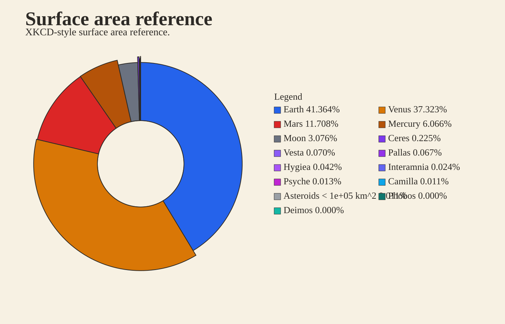
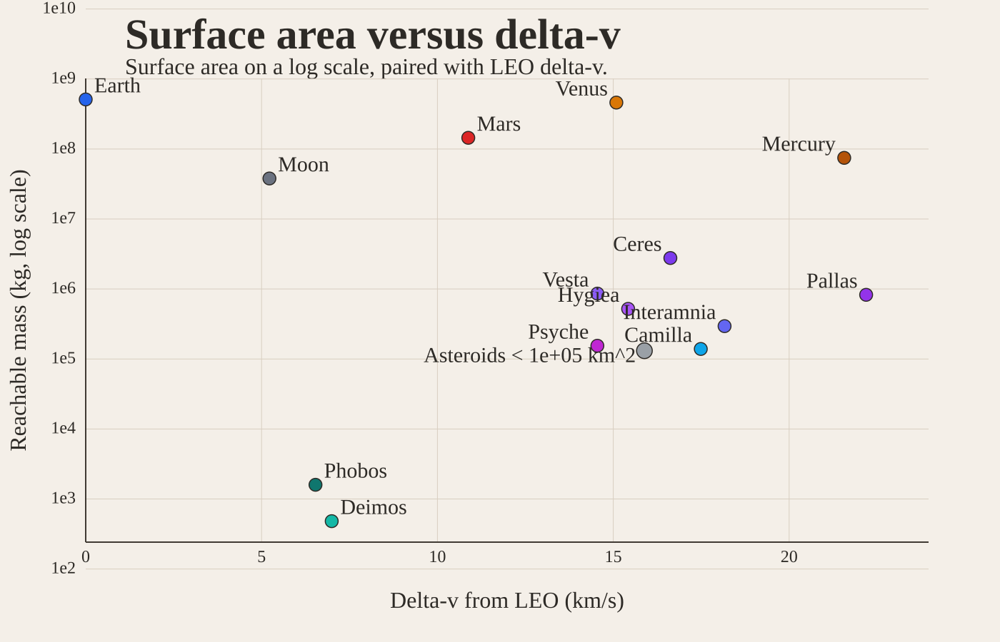
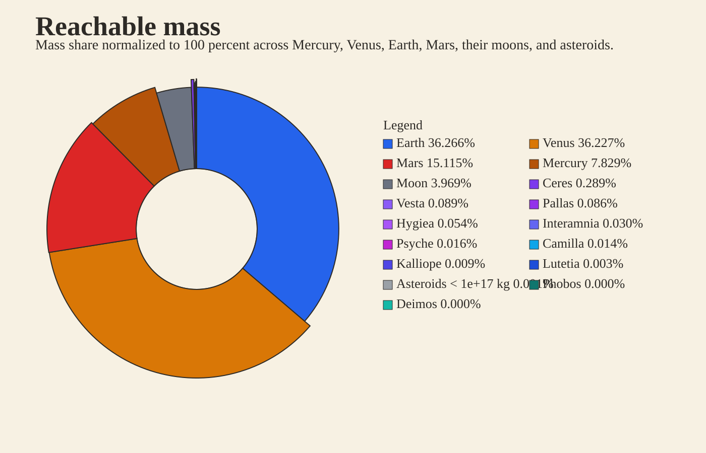
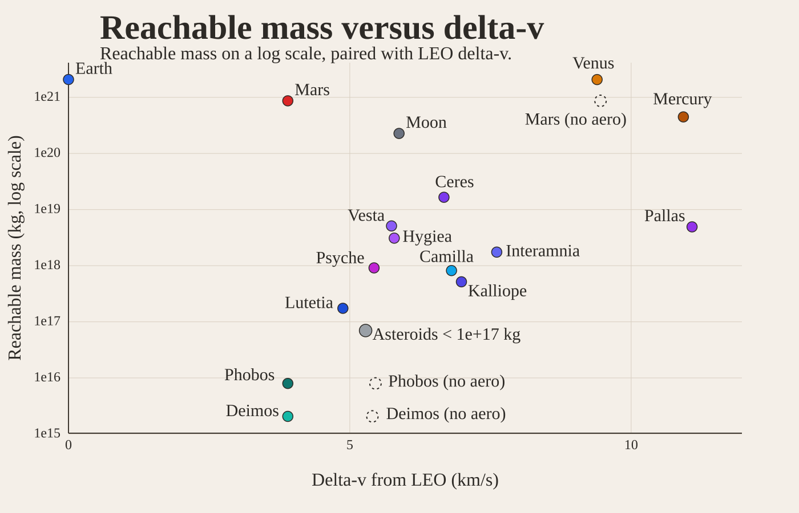
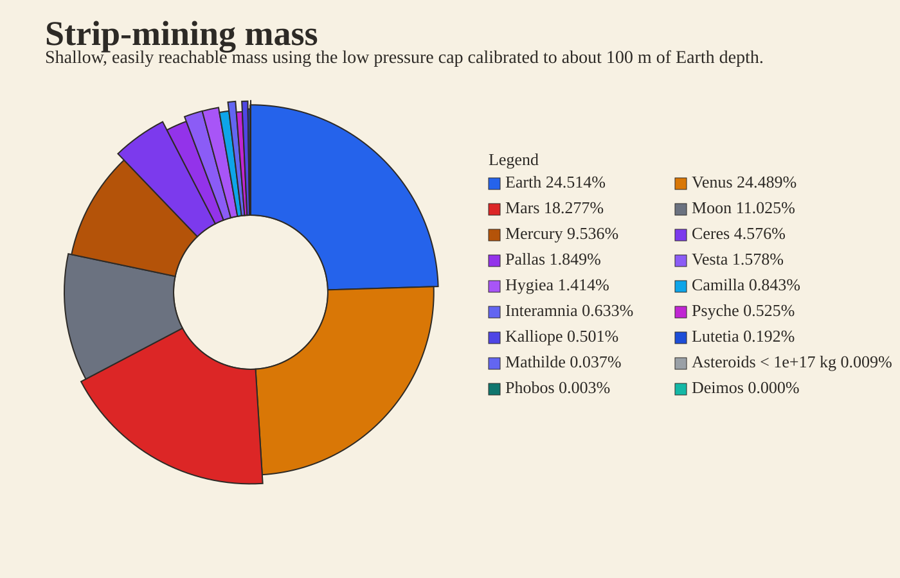
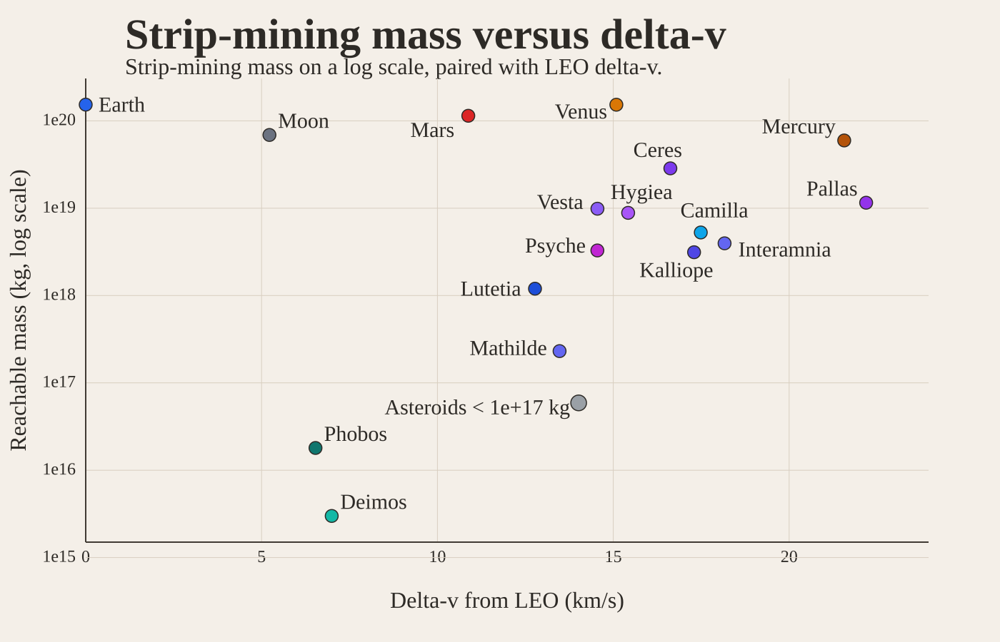
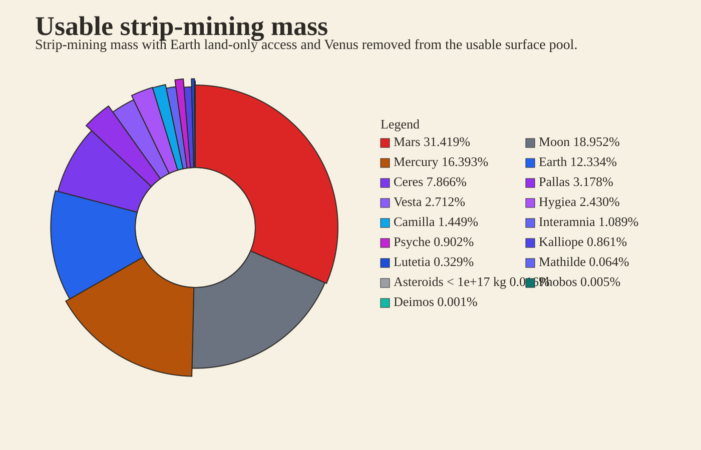
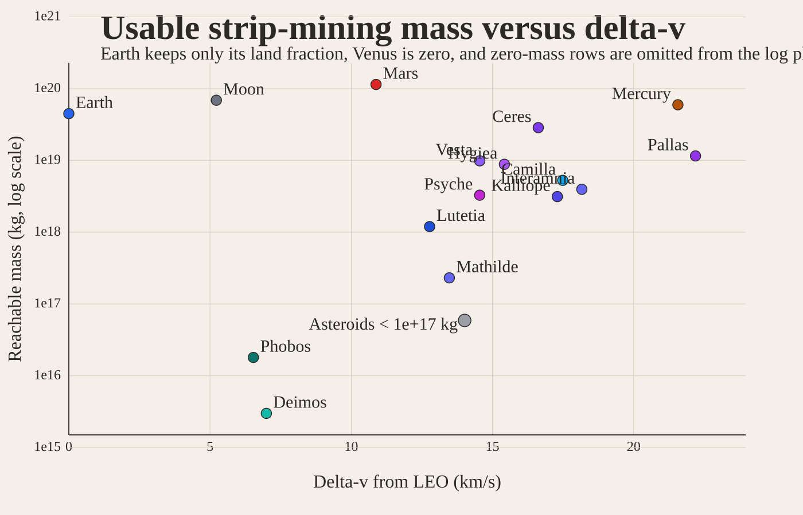

# Visuals

## Surface Area Reference

## Surface Area Scatter

## Reachable Mass

## Reachable Mass Scatter

## Strip-Mining Mass

## Strip-Mining Scatter

## Usable Strip-Mining Share

## Usable Strip-Mining Scatter

## Notes

- The wheel charts use color-only wedges and a side legend because the in-slice labels were too hard to read.
- Small asteroids are collapsed into compact `Asteroids < ...` buckets.
- Each scatter uses the same grouped inputs as its matching wheel chart.
- The usable strip-mining plots keep Earth land-only and set Venus to zero usable surface; zero-mass rows are omitted from the log scatter.
